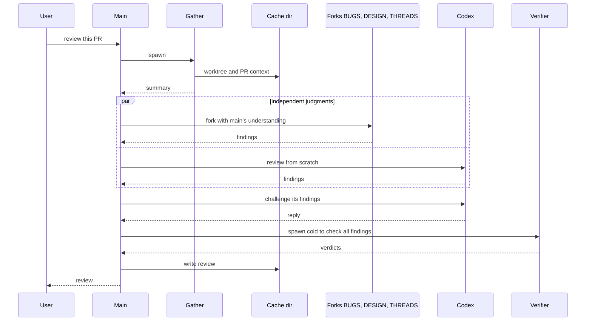

# review-pr

Reviews a GitHub PR for a reviewer who has little context. It explains what the PR does and why, how it does it, the bugs and design issues found by reading the code, and the status of every unresolved discussion. It is read-only. The one exception is `post`: it posts the findings you name, as one signed GitHub review. The skill is manual-only (`disable-model-invocation`).

```
/review-pr <PR number> [--codex] [--tests [pattern]] [--html] [--fresh]
/review-pr post <ids> as <comment|approve|request changes|pending>
/review-pr gc
```

## Agents

| Agent | Type / model | Runs | Produces |
|---|---|---|---|
| gather | general-purpose, sonnet | always | worktree at head, `meta.json`, `dossier.md`, `threads.md`, `linear.md`, `decoherence.md`, `fix-history.md`, a summary with `mode:` |
| codex | Codex CLI, gpt-6-astra high, read-only | `--codex` | independent bug and design findings (CB, CP, CD), then one challenge reply |
| BUGS | fork of main | full, incremental | bugs (B) and pre-existing defects (P) |
| DESIGN | fork of main | full, incremental | design and decoherence findings (D) |
| THREADS | fork of main | unresolved threads or asks exist (same-head: only if threads changed) | §5 discussion table |
| verifier | general-purpose, opus, cold | after the forks | one verdict per id in `verify.md` |
| tests | general-purpose, sonnet (opus after two failed bootstraps) | `--tests` | test and benchmark table for §7 |
| render, drafter | general-purpose, sonnet | `--html`, `post` | `review.html` to publish, `post.json` with comment wording |

## Modes

- **full**: first run, `--fresh`, last run unfinished, old head gone, or interdiff too big (over half the PR's lines or ~1500). Every step runs; the flags still gate codex, tests and HTML.
- **same-head**: the head has not moved. No BUGS or DESIGN fork; THREADS only if threads changed; codex only with `--codex` and no prior §6. `review.md` is edited in place.
- **incremental**: the head moved by a small interdiff. All three forks run; BUGS and DESIGN mark each prior id fixed, still present or moot and hunt new ones only in `interdiff.md`. The last review is archived under `history/<old7>/`.
- `--codex`: codex reviews in the background without seeing `notes.md`; its findings are matched to the forks', challenged once in a resumed session, and judged by the verifier. Disagreements go in §6.
- `--tests [pattern]` bootstraps the worktree and runs matching tests, or those touching the changed files. `--html` publishes `review.md` as an Artifact.
- `post`: you name items and the action; main writes `post-plan.md`, a sonnet drafts `post.json`, main checks it and shows a dry run, and `post_review.py` posts one signed review pinned to head.
- `gc`: runs `gc.sh --keep 6 --days 7`, keeping the markdown and removing old worktrees and those of merged or closed PRs.

## Dependencies

| Dependency | Needed for | Required? |
|---|---|---|
| `gh`, `git`, `python3` | gather, the dossier and thread scripts, posting | yes |
| Codex CLI (`codex`), and the `codex` skill for its flags | the independent pass | only with `--codex` |
| `decoherence` skill's script (`~/.claude/skills/decoherence/scripts/decoherence.cjs`, needs `node`) | `decoherence.md` and the decoherence judgment | no: written as unavailable |
| Linear MCP or the `linear` agent type | `linear.md` | no |
| `writing-well` skill | the prose rules for `review.md` | no: report-format.md has the essentials |
| `artifact-design` skill and the Artifact tool (built into Claude Code, not in this repo) | `--html` | only with `--html` |

## Flow



Files live in `${XDG_CACHE_HOME:-~/.cache}/review-pr/<owner>-<repo>-pr-<n>/`.
