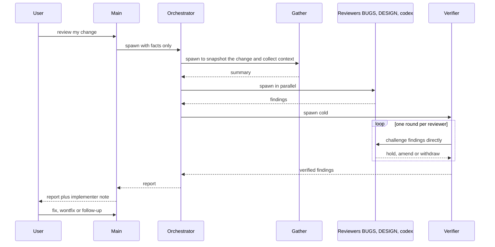

# self-review

Reviews your own change before you post it. It covers the working copy (commits not yet in the base, plus staged, unstaged and untracked files) against its base branch. Reviewers that never saw how the change was built find bugs and design issues. A cold verifier debates those findings with them. You then decide what to fix, and each won't-fix decision is made public. Decisions are kept in `decisions.md`, and later runs' reviewers treat them as settled. The main agent never tells a subagent what the change is for, and prompts are verbatim. The skill reuses review-pr's checklist, finding formats and dossier script, but does not run review-pr.

```
/self-review [--base <branch>] [--no-codex] [--fresh] [focus...]
```

## Agents

| Agent | Type / model | Runs | Produces |
|---|---|---|---|
| orchestrator | general-purpose, opus | always | runs the review and returns `report.md` |
| gather | general-purpose, sonnet | always | snapshot commit, `meta.json`, `dossier.md`, `linear.md`, `decoherence.md`, `fix-history.md`, `interdiff.md`, a summary with `mode:` |
| codex | Codex CLI, gpt-6-astra high, read-only | by default, off with `--no-codex` | `findings-codex.md` (CB, CP, CD, with fix options) |
| BUGS | general-purpose, opus | full, incremental | `findings-bugs.md` (B, P, with fix options) |
| DESIGN | general-purpose, opus | full, incremental | `findings-design.md` (D, with fix options) |
| verifier | general-purpose, opus | after all reviewers | `verify.md`: verdicts, verified bugs and design, disagreements, questions |
| stand-in | general-purpose, opus, spawned by the verifier | respawn mode, one per challenged reviewer | answers the challenges |
| linear | `linear` agent type | follow-ups the user confirms | Linear issues, keys written to `decisions.md` |

## Modes

- **full**: first run, `--fresh`, old snapshot gone, or interdiff too big (over half the change's lines or ~1500).
- **incremental**: small interdiff (a plain diff, or a range-diff after a rebase). Reviewers mark each prior id fixed, still present, moot or decided, and hunt new ones only in `interdiff.md`.
- **unchanged**: same tree and same base. The orchestrator returns the last report; `--fresh` forces a new review.
- **Challenge mode**, from `$CLAUDE_CODE_ENTRYPOINT`: `cli` (interactive) → the verifier resumes the original BUGS or DESIGN agent with SendMessage (`resume`); anything else, such as `sdk-cli` under `claude -p`, would route the reply to the main agent, so the verifier spawns a stand-in with the reviewer's prompt (`respawn`). Codex is resumed by session id in both. One round per reviewer.

## Flow



## Dependencies

| Dependency | Needed for | Required? |
|---|---|---|
| `review-pr` skill, in the sibling directory `../review-pr` | `checklist.md`, the §3/§4 finding formats, `scripts/dossier_files.py` | yes |
| Codex CLI (`codex`), and the `codex` skill for its flags | the third reviewer and its challenge round | default; skip with `--no-codex` |
| `decoherence` skill's script (`~/.claude/skills/decoherence/scripts/decoherence.cjs`, needs `node`) | `decoherence.md` for DESIGN | no: written as unavailable |
| Linear MCP or the `linear` agent type | `linear.md`, filing follow-ups | no |
| `create-pr` skill | adds the "Deliberately not changed" section from `decisions.md` to a new PR | no |
| `gh`, `git`, `python3` | base detection, PR body edits, the dossier script | yes |
| Claude Code with nested subagents (3 levels) | orchestrator → reviewers → stand-ins | yes |

Files live in `${XDG_CACHE_HOME:-~/.cache}/self-review/<owner>-<repo>/<branch>/`, with `/` in the branch turned into `--`.
